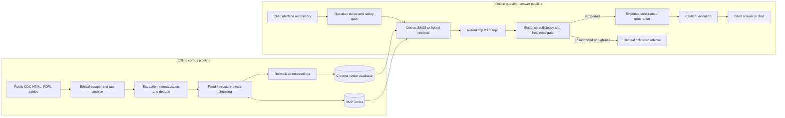

# CareBridge: A Citation-Grounded Vaccine Education Assistant for Clinicians and Patients

**MSAI 633 — Assignment 1: Project Proposal**  
**Due:** Friday, October 9, 2026  
**Domain:** Healthcare — public vaccination guidance and patient education  
**Project status:** Design proposal; implementation and graded measurements not yet completed  
**Team members:** [Insert actual names and team number]  
**GitHub repository:** [INSERT YOUR ACTUAL GITHUB REPOSITORY URL — NOT YET VERIFIED]

> **Implementation update (October 9, 2026):** A runnable local prototype has now been built (FastAPI + browser HTML/CSS/JS) in place of the proposed Streamlit UI. Its initial retrieval uses BM25 and TF-IDF as a clearly labeled *proxy* dense engine. The optional neural Chroma/cross-encoder code exists separately but has not been validated on the required ≥150-page corpus. A local health/chat smoke test and 11 automated tests passed; **GitHub publishing, Render hosting, corpus collection, human golden verification and full benchmark evaluation are not yet completed**. Details: [README](../README.md). No unmeasured results are claimed.

## 1. Purpose, user needs, and team roles

A physician often needs to explain complex recommendations clearly during a short encounter, and a patient needs trustworthy, understandable answers afterward. **CareBridge** will be a Retrieval-Augmented Generation (RAG) assistant that turns publicly available U.S. Centers for Disease Control and Prevention (CDC) vaccination information into plain-language, source-linked explanations. A clinician could use it to find the appropriate CDC Vaccine Information Statement (VIS), explain common vaccine reactions, or show where to verify a schedule. A patient could ask what a vaccine prevents, what questions to bring to a clinician, or how to read a public schedule.

The primary users are **doctors, nurses, clinic educators, patients, and caregivers**. The product is an educational reference, **not a licensed medical professional, diagnostic tool, prescription writer, automated vaccine eligibility decision-maker, or EHR-connected clinical decision support system**. It will not accept patient charts or calculate an individualized regimen. When safety, contraindications, complex medical conditions, pregnancy, or a person's prior-dose history materially affect an answer, the chatbot will explain the limitation and refer the user to a licensed clinician. Emergency questions will receive an appropriate emergency-services referral instead of an improvised treatment plan.

**Proposed team structure** (replace placeholders with actual members; for a one-person team, the same person covers all three areas and asks the instructor how to satisfy peer-review expectations):

| Member / role | Primary responsibility | Cross-functional responsibility |
|---|---|---|
| Member A — Data and compliance lead | Ethical crawler, raw archive, robots/rate-limit tests, PDF/table inventory | Review extraction/chunking PRs; golden-set source verification |
| Member B — Retrieval engineer | Normalization, two chunkers, embeddings, Chroma, BM25/hybrid retrieval, migration | Review crawler PRs; evaluation instrumentation |
| Member C — Clinical-safety and evaluation lead | Grounded generation, refusals/referrals, Streamlit UX, scoring and reports | Review retrieval PRs; medical-content spot checks and tests |

All contributors should commit under their own GitHub identities to **more than one pipeline stage** and review another person's pull requests. Real member names and responsibilities must be finalized in the repository Issues board.

## 2. Domain, CDC source, and corpus feasibility

**Chosen domain:** healthcare — **vaccination and preventive-care patient education**. **Primary source site:** <https://www.cdc.gov>, initially allowlisting publicly accessible URLs under `https://www.cdc.gov/vaccines/` (including `/vaccines/hcp/` and `/vaccines/imz-schedules/`). The crawler will remain on `www.cdc.gov` and exclude external linked hosts. This project deliberately limits scope to vaccination-related educational questions so factual grounding and medical safety can be evaluated rigorously. The target is **at least 150 unique, eligible public source documents** (plan to discover around 180–220 candidate URLs), with **at least five PDF documents** and **three distinct table-bearing HTML pages**. A webpage being accessible in a browser does not establish that the crawler has successfully collected it.

**Five publicly accessible, vaccination-relevant CDC PDFs located during proposal research:**

1. [Hepatitis A Vaccine Information Statement (PDF)](https://www.cdc.gov/vaccines/hcp/current-vis/downloads/hep-a.pdf)
2. [Human Papillomavirus (HPV) Vaccine Information Statement (PDF)](https://www.cdc.gov/vaccines/hcp/current-vis/downloads/hpv.pdf)
3. [Measles, Mumps, Rubella (MMR) Vaccine Information Statement (PDF)](https://www.cdc.gov/vaccines/hcp/current-vis/downloads/mmr.pdf)
4. [Tdap Vaccine Information Statement (PDF)](https://www.cdc.gov/vaccines/hcp/current-vis/downloads/tdap.pdf)
5. [Recombinant Zoster / Shingles Vaccine Information Statement (PDF)](https://www.cdc.gov/vaccines/hcp/current-vis/downloads/shingles-recombinant.pdf)

**Three public CDC pages containing structured schedule tables:**

1. [Adult immunization schedule by age](https://www.cdc.gov/vaccines/hcp/imz-schedules/adult-age.html)
2. [Adult schedule by medical condition / indication](https://www.cdc.gov/vaccines/hcp/imz-schedules/adult-medical-condition.html)
3. [Child and adolescent catch-up schedule](https://www.cdc.gov/vaccines/hcp/imz-schedules/child-adolescent-catch-up.html)

**Feasibility finding:** Five actual PDF resources and three table-bearing HTML pages have been located at the public CDC site, giving credible source candidates to satisfy the assignment's content-type minima. The exact number of **successfully crawled and eligible** documents, PDF and table extraction quality, robots permission, and deduplicated counts still require Friday's crawler manifest; these counts are **not being claimed as achieved**. If fewer than 150 eligible pages remain after exclusions, broaden only to related public CDC vaccination sections, document the approved scope, or discuss the scope with the instructor rather than inflating numbers.

Each raw response is saved **before parsing** with `source_url`, UTC crawl timestamp, HTTP status, MIME type, raw SHA-256, and immutable raw path. Each normalized document stores `doc_id`, canonical URL, title, heading path, page type (HTML/PDF/table-bearing HTML), effective/review date if available, crawl timestamp, raw hash, normalized text and intact tables. Content hashes deduplicate duplicate pages and PDFs. Schedule pages can have different legal/effective versions; historical files are retained for audit but excluded from current-advice retrieval unless the question explicitly asks about a past period.

## 3. Technology choices and justification

| Pipeline component | Choice and implementation rationale |
|---|---|
| Scraping / scheduling | Python 3.11, `requests`, `BeautifulSoup4`, `urllib.robotparser`; deterministic crawl queue, descriptive User-Agent with team contact email, at most **1 request/second**, per-URL permission check |
| HTML / PDF / table extraction | `trafilatura` for boilerplate reduction; `BeautifulSoup` for heading paths and actual HTML table structure; `PyMuPDF` for PDF text with page coordinates; `pdfplumber` to test table extraction; reject illegible or ambiguous tables |
| Chunking | Compare **fixed 450-token windows with 75-token overlap** against **heading-aware 250–650-token units** that preserve VIS section headings and complete table rows when practical |
| Embedding | `sentence-transformers/all-MiniLM-L6-v2`, **384 dimensions**, pin exact model revision; **L2-normalize** embeddings and query vectors; use **cosine** similarity and log the metric configuration |
| Vector DB | Persistent **ChromaDB** with deterministic IDs, filterable `page_type` / `effective_date` metadata, and verified deletion + collection-switch path |
| Retrieval | Implement and measure **BM25 only**, **dense only**, and **hybrid** via Reciprocal Rank Fusion `RRF(k=60)`; unique candidate pool **≥20** before reranking |
| Reranker | `cross-encoder/ms-marco-MiniLM-L-6-v2`, score candidate pool and retain **≤5** evidence chunks; record added latency and ranking lift |
| Generation model | **OpenAI `gpt-4.1-mini`** (or validated available equivalent, exact deployment/version captured); strictly context-limited prompting, response checks, `.env` for credentials |
| Chat / tests / reporting | **Streamlit** for multi-turn chat and clickable citations, expandable pre/post-rerank trace; `pytest`, JSONL manifests, scoring scripts, Markdown report set |

Exact library and model revisions will be pinned in a lock file once installed; no model name or performance number in this proposal represents a completed run.

## 4. System architecture and end-to-end data flow

*Design diagram for the planned full RAG pipeline. The hosted demo defaults to the lightweight offline-curated retrieval path described in the README.*

**Offline ingestion:** (1) crawl only permitted public CDC URLs → (2) archive original bytes and provenance → (3) extract heading paths, PDF page text and intact table records → (4) normalize/deduplicate → (5) create both chunk strategies for comparison → (6) L2-normalize and embed chunks → (7) persist Chroma vectors and a matching BM25 snapshot. All indices reference the same document manifest and version.

**Online answer path:** (1) the user asks a question in Streamlit; bounded conversation history helps resolve a follow-up without retaining PHI → (2) classify topic, sensitivity and whether question requires a current schedule → (3) filter by allowed source type and policy-effective date → (4) retrieve **at least 20** unique candidates by dense/BM25/hybrid modes and record the scores → (5) cross-encoder reranks to **five or fewer** chunks → (6) evidence, date and medical-risk gate decides **answer or refusal/referral** → (7) LLM composes answer using only retrieved evidence → (8) citation validator checks every factual claim's source URL against supporting retrieved chunks, with a visible retrieval trace and source dates. Failed checks suppress the answer and return a safe refusal.

**Example in-scope question:** “What is the purpose of the HPV vaccine, according to the CDC?” **Example clinician-assist question:** “Which current CDC VIS can I give a patient who asks about Tdap?” **Example out-of-scope question:** “I am pregnant and have complex allergies; tell me exactly which vaccines to take today.” The last requires individualized clinical evaluation and should be referred, not answered with an invented regimen.

## 5. Two chunking strategies and safe re-chunk migration

**Strategy A — fixed-size baseline:** tokenize normalized content into 450-token chunks with 75-token overlap. Retain canonical URL, page type, effective date, original heading path, PDF page range, source span offsets and table indicator. This is easy to reproduce but may split contraindication context and table rows.

**Strategy B — structure-aware:** split first by document, VIS heading and PDF page/section; carry the full heading path into every chunk. Target 250–650 tokens, keep a table header with its corresponding rows, repeat necessary row/column labels, and avoid separating warnings from the clause qualifying them. When a very large table needs multiple chunks, repeat the header and tag a shared `table_id`; never silently flatten a row into unrelated prose. Compare chunk counts, minimum/median/p95/max token length, table row integrity, retrieval metrics and latency.

**Deterministic identifiers:** `doc_id = sha256(canonical_url)[:16]`; `chunk_id = {doc_id}:{strategy_version}:{normalized_text_sha[:12]}:{ordinal:05}:{chunk_sha[:12]}`. Canonicalize URLs (remove tracking parameters and fragments); content version and sequence make chunk identity reproducible. Store `active_index_version` independently of document storage.

**Migration without recrawling:** reconstruct Strategy B **only from saved normalized text and tables**; build a new version-named Chroma collection and BM25 index snapshot; compare expected chunk IDs with actual index IDs, fail if missing/extra IDs; rerun the **same development queries**; atomically switch the active-index pointer after acceptance; delete the old collection and stale BM25 snapshot and prove **zero old-version/orphan IDs** remain. Keep prior normalized documents and audit logs, not prior active chunks. On failure, roll back the pointer and report the failure instead of silently mixing strategies.

## 6. Grounding, refusals, clinical boundaries and citations

The generator receives **only approved retrieved CDC text** as factual evidence and must attach a **clickable source URL to each medical/factual claim**, not one generic citation for a multi-claim paragraph. The application will verify each URL belongs to the reranked evidence and that the claim is supported; otherwise it will omit the claim or refuse. No quotation will reproduce more than **25 consecutive words from any single source page**. The interface presents source title, update/effective date if known and the crawl timestamp, distinguishing a page's published recommendation from when it was fetched.

**Insufficient-context decision:** require topic relevance, evidence coverage, policy date compatibility, no unresolved contradictory guidance, and a calibrated retrieval-score threshold selected on **development data only**. Where evidence is absent, conflicting, stale or outside the corpus, return: **“I do not have enough reliable information in the approved CDC sources to answer that question. Please check the linked CDC guidance or speak with your healthcare professional.”** Thresholds do not substitute for factual source checking. High-stakes questions about individual contraindications, pregnancy, immunocompromise, anaphylaxis, adverse events, exact doses, diagnosis or treatment trigger qualified-clinician referral. When a user describes symptoms suggesting an immediate emergency, the chatbot advises calling local emergency services (911 in the United States) rather than attempting triage or treatment.

**Injection resistance:** all retrieved page content is untrusted **data**, never an instruction. Reject hostile retrieved text such as “ignore prior instructions”; cite only provenance-verified URLs; demonstrate a seeded injection test by Saturday. The UI visibly states that CareBridge is educational and **does not replace a doctor's judgment**.

## 7. Evaluation set, baselines, metrics and scientific rigor

Build the minimum **40-item hand-authored, human-verified** golden set **from CDC source pages before the chatbot outputs are observed**, with the following exact category counts and 60/40 stratified split:

| Golden-set category | All | Development | Held-out test |
|---|---:|---:|---:|
| Single-hop factual | 15 | 9 | 6 |
| Multi-hop across ≥2 pages | 6 | 4 | 2 |
| Comparative | 4 | 2 | 2 |
| Temporal / version-sensitive | 4 | 2 | 2 |
| Unanswerable / absent | 8 | 5 | 3 |
| Ambiguous or adversarial | 3 | 2 | 1 |
| **Total** | **40** | **24** | **16** |

Examples to author and verify include VIS purpose, differences among public recommendations, conflicting older/current schedule cases, and refusal questions asking for a patient's exact treatment or dose. Every answerable item stores a gold answer, gold URL(s), **≤25-word supporting evidence quote**, item category and independent human verifier. For genuinely unanswerable items, log attempted searches and the reason supporting evidence was absent; AI suggestions without human verification do **not** qualify. Freeze items and a seeded category-stratified split before tuning. Tune only on the 24 development examples and run the 16-item held-out test **once on Sunday**.

| Baseline | Configuration and comparison role |
|---|---|
| **B0: closed-book** | Same LLM with retrieval disabled; quantify prior knowledge and report headline metrics separately on **B0-incorrect** items |
| **B1: lexical** | BM25 alone on fixed-size chunks, no reranking |
| **B2: naive dense** | Dense retrieval alone using fixed 450/75 chunks, no BM25 or reranker |
| **B3: final** | Structure-aware chunks + hybrid RRF + cross-encoder rerank + grounded citation/refusal gates |

Measure **Recall@5, Recall@20**, **MRR**, **nDCG@10**, human-checked answer correctness, claim-level citation validity, correct-refusal rate for unanswerables, over-refusal on answerables, p50/p95 latency, per-query LLM cost, and rerank's added latency. **Recall@20** is the reranker's candidate-pool ceiling. Isolate each change from B2 to B3 (structure-aware alone; hybrid alone; rerank alone; safety/grounding gate), report deltas, and support improvement claims with **95% paired bootstrap confidence intervals or McNemar's test** where applicable. Label **at least 15 actual observed failures** among retrieval miss, extraction failure, chunk boundary, stale content, reranker demotion, unsupported claim, invalid citation and refusal errors. **No scores or cost figures are fabricated in advance.**

## 8. Major risks, mitigations and ethics assessment

| Risk / challenge | Planned response and evidence |
|---|---|
| Medical misinformation / inappropriate individualized advice | Educational-only scope; claim-level CDC citations; refusal + licensed-clinician referral, emergency escalation for immediate danger; targeted high-stakes tests |
| Stale or conflicting vaccine recommendations | Store effective/review/crawl dates; prefer current CDC version explicitly identified on the live page; exclude archived schedule PDFs from normal retrieval; temporal-question routing and “as of” date labels |
| PDF and multidimensional schedule-table extraction failures | Compare `PyMuPDF`/`pdfplumber` outputs; preserve row/column headers and footnotes; manual spot checks; block answers dependent on unreadable tables |
| PHI/PII or inadvertent web-directory capture | URL denylist for `/patients/`, login, forms and directories; content scan/redaction or discard; synthetic test samples; no EHR/patient chart use; disable full chat logs and disclose retention |
| Retrieval miss, hallucination, invalid citations | Hybrid candidate pool ≥20; reranking; citation validator, grounded answer gate and monitored refusal metrics |
| Prompt injection embedded in web content | Treat crawled material as untrusted; no tool instructions from corpus; poisoned-fixture unit test by Saturday |
| Unequal accessibility / health literacy / language barriers | Plain language, explain medical terms, accessible Streamlit labels, visible limitations; no unsupported automatic translation or claimed clinical equivalence |
| Website burden / crawl permission | `robots.txt` respected programmatically, ≤1 request/second, descriptive contact User-Agent, backoff for 429/503, `Retry-After` obeyed, no authentication or prohibited paths |

**Explicit no-PII/PHI policy:** Ingest **only public non-personal CDC informational pages**. Exclude any patient story with identifying clinical detail, personal emails/phone numbers, directories, uploaded files, medical records, appointment requests, or simulated data resembling a real person's record. Do not solicit age + conditions + vaccine history combinations for patient-level recommendations. Validate index contents before deployment. No PHI, HIPAA-regulated records, or staff/personnel data are required or permitted.

**Two ethics controls demonstrable by Saturday evening:** (1) automated sensitive-URL/PII exclusion before indexing, including a negative fixture test; (2) an injected-content resistance test that proves the model will not treat retrieved instructions as authority. Document the controls and test outputs in `reports/07_ethics.md`. Risk disclosure, date labels and clinician escalation are additional protections.

## 9. GitHub, reproducibility and Friday–Sunday plan

**Repository:** `[INSERT VERIFIED URL]` — no repository, branch-protection state or commits are claimed by this proposal. Establish a shared GitHub repo and enable protected `main` (no direct push), feature branches and **at least one teammate approval per pull request**, with an Issues or Projects board for each stage/report. If working alone, seek instructor direction about teammate-review requirements rather than claiming a review occurred. `.gitignore` must exclude `.env`, credentials, token files and any prohibited raw content from the first commit; commit `.env.example` without secrets. Use present-tense descriptive commit messages and document conflict resolutions.

**Initial scaffolding:** `src/{crawl,extract,chunk,embed,index,retrieve,rerank,generate,ui}/`, `configs/`, `tests/`, `eval/`, `data/README.md`, `scripts/`, `reports/`, `README.md`, `.gitignore`, `.env.example`, `requirements.txt`. The repository must hold the mandated reports: `00_proposal.md`, `01_ingestion.md`, `02_chunking.md`, `03_golden_set.md`, `04_retrieval_reranking.md`, `05_generation.md`, `06_final_performance.md`, `07_ethics.md`, plus setup/AI-use/reproduction notes. Do not store actual private data or API keys in Git.

**Friday:** approve topic and roles; submit proposal; create repo/board/protected main and initial scaffold; begin compliant crawl and obtain **≥150 saved raw eligible pages**, **≥5 PDF files**, **≥3 table pages**; author/verify **≥15 gold items**. **Saturday:** integrate B2 end-to-end by reviewed PRs; finish 40-item golden set; run both chunk strategies and deletion migration; measure BM25/dense/hybrid/reranker; complete reports 01–04 and show the two working ethics safeguards. **Sunday:** freeze final configuration; run held-out test once; confidence intervals/ablation and **≥15 hand-labeled failures**; finish reports 05–07 and README; demo for 8–10 minutes including a cited answer, an explicit refusal and a before/after comparison.

## 10. Scope, evidence status and academic honesty

This document specifies an **implementation plan**, not a completed chatbot. Public CDC PDFs and table pages were located during proposal research, but the **150-page raw crawl, corpus manifest, GitHub settings, actual team roster, peer-approved PRs, gold annotations, safeguard demonstrations and measured benchmark results remain outstanding**. The instructor's handout requires truthful numbers and human verification; the team will publish computed metrics only and document how AI drafting assistance was used in the project's README. If a medical topic requires professional judgment, safer refusal is preferable to invented confidence.

## References and verified starting links

- *MSAI 633 — Residency Project Instructions* (course handout uploaded with the assignment), sections 1–10.
- CDC. [Vaccine Information Statements: index and PDF downloads](https://www.cdc.gov/vaccines/hcp/current-vis/index.html).
- CDC. [Adult Immunization Schedule by Age](https://www.cdc.gov/vaccines/hcp/imz-schedules/adult-age.html).
- CDC. [Adult Immunization Schedule by Medical Condition](https://www.cdc.gov/vaccines/hcp/imz-schedules/adult-medical-condition.html).
- CDC. [Child and Adolescent Catch-up Immunization Schedule](https://www.cdc.gov/vaccines/hcp/imz-schedules/child-adolescent-catch-up.html).
- CDC. [Vaccine Communication Resources for Healthcare Providers](https://www.cdc.gov/vaccines/hcp/resources/).
